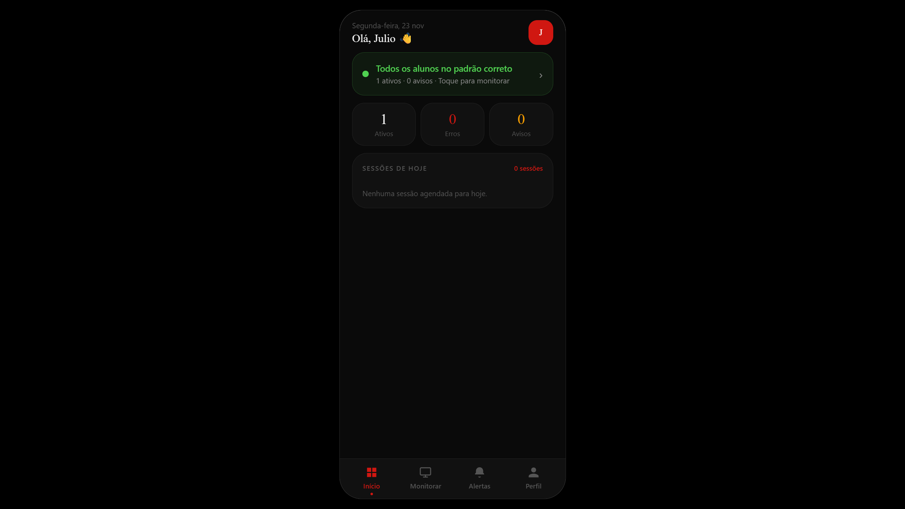
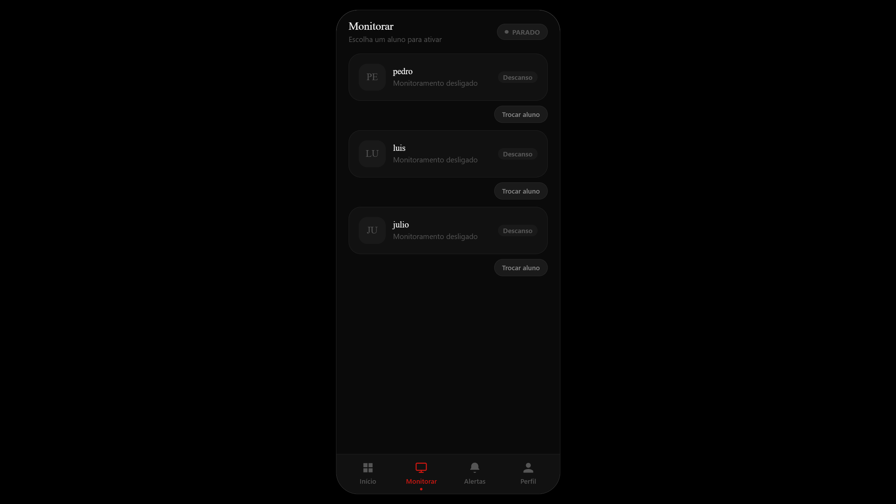
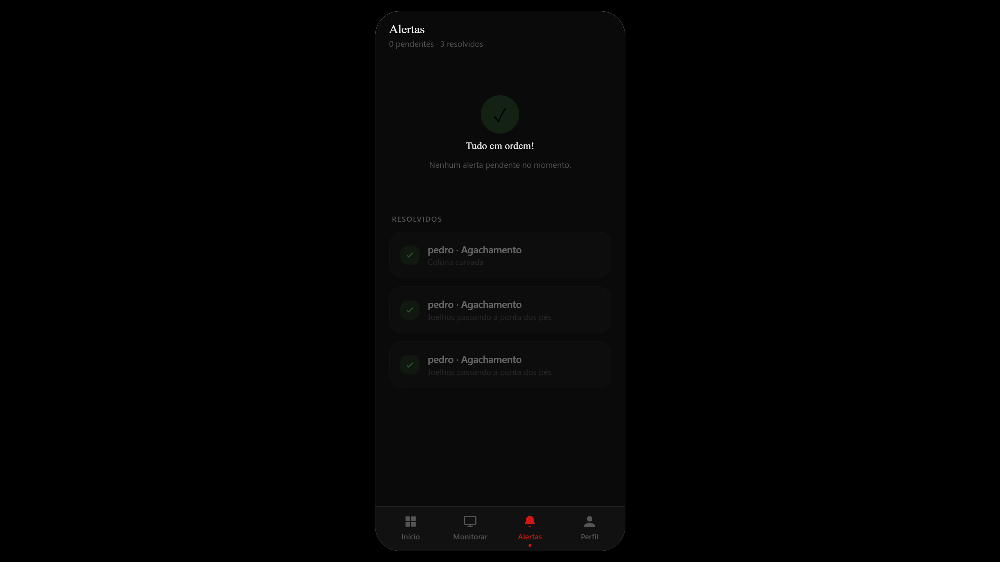
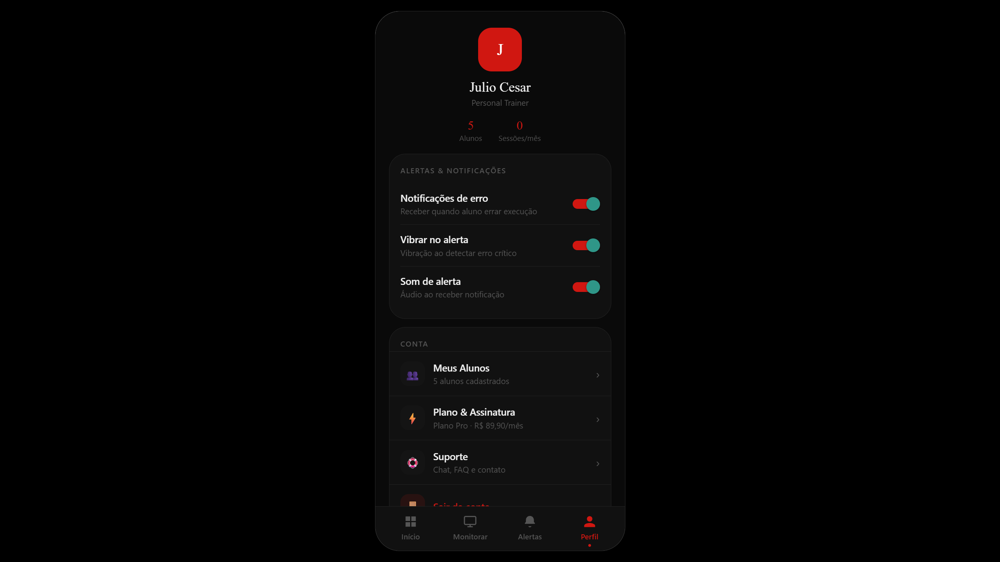

# Smart-Mirror

Assistente para personal trainers: a câmera analisa a execução dos exercícios em tempo real com IA (Gemini) e pose estimation (MediaPipe), gera alertas de postura e acompanha os alunos pelo app.

O Smart-Mirror é um protótipo de sistema para monitorar a execução de exercícios físicos. Uma câmera filma o aluno, o MediaPipe identifica 33 pontos do corpo e calcula os ângulos das articulações para avaliar a execução dos movimentos.

## Capturas de tela

### Tela inicial


### Início



### Monitorar



### Alertas



### Perfil



## Como funciona

O projeto possui três partes:

| Parte | Função | Tecnologias |
|---|---|---|
| `app/` | Aplicativo para celular e web | Expo, React Native |
| `api/` | Login, alunos, sessões e alertas | Node.js, Express, PostgreSQL |
| `camera/` | Análise por câmera e por vídeo | Python, OpenCV, FastAPI, MediaPipe, Gemini |

Há também uma versão web do visual, feita somente com HTML, CSS e JavaScript.

## Principais recursos

- Pose estimation em tempo real
  - Esqueleto desenhado no vídeo
  - Ângulos exibidos ao vivo
  - Análise de joelhos, cotovelos, quadris, ombros e inclinação do tronco
- Análise por IA de clipes gravados
  - Troca automática de versão do Gemini
  - Alternância quando uma versão demora ou falha
- Até 3 alunos monitorados ao mesmo tempo
  - Cada aluno possui uma sessão própria
  - Alertas individuais
  - Vídeo próprio
- Alertas de postura
  - Alertas marcados como resolvidos pelo personal
- Três perfis de acesso
  - **Personal:** gerencia alunos e alertas
  - **Aluno:** realiza o auto-monitoramento
  - **Visitante:** utiliza o sistema sem uma conta
- Versão de demonstração
  - Dados de exemplo
  - Envio de vídeos de exercícios para análise
- Relatórios em TXT
  - Um arquivo por análise
  - Informações sobre exercício, repetições, status, correção e risco de lesão

## Como rodar no Windows

1. Instale o Node.js e o Python 3.
2. Crie o arquivo `camera/.env` com a seguinte variável:

   ```env
   GEMINI_API_KEY=sua_chave
   ```

3. Execute o arquivo `3-ABRIR-TUDO.bat` com um clique.

   Ele abre a API, o módulo da câmera e o aplicativo.

> O login com banco exige PostgreSQL. Para criar o banco, use o arquivo `2-CRIAR-BANC0.bat`.
>
> A versão de demonstração e o modo visitante funcionam sem banco.

## Aviso

Este é um protótipo educacional. As análises da IA servem de apoio e não substituem a orientação de um profissional de educação física ou de saúde.
